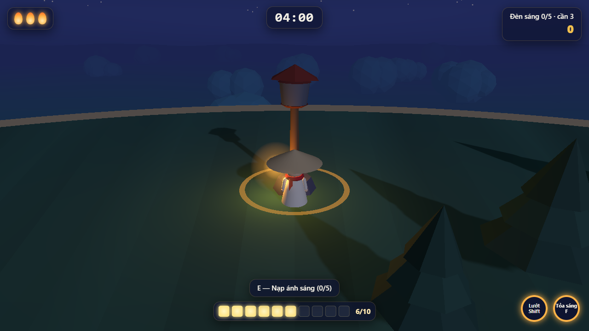

# Đảo Đèn Lồng

> **Bản phát hành:** [Release v1.0.0](../../releases/tag/v1.0.0) · **Video demo:** [docs/demo/demo.mp4](docs/demo/demo.mp4) (cũng đính kèm Release)
> Day 12 · AI SDLC Lab · Dương Ngọc Tuyên · 2A202603511

Game 3D góc nhìn thứ ba chạy trên trình duyệt. Bạn điều khiển **Mây**, người giữ đèn nhỏ tuổi, đi qua **3 Đêm, 3 hòn đảo**: Đảo Bến, Đảo Cau, Đảo Chuông. Đèn **cạn dầu dần** và Bóng Mực còn hút dầu, nên mục tiêu mỗi Đêm là **giữ đủ đèn sáng tới bình minh** (Đêm 1 cần 3/5, Đêm 2 cần 4/6, Đêm 3 cần 5/7), đồng thời né **Bóng Mực** và **Gió Lạc**.

Toàn bộ luật chơi nằm trong `src/sim/`, là JavaScript thuần, chạy tất định, theo **số chuẩn của Ticket-02**. Bản web và chế độ headless (**Test Contract v1.3**) cùng chạy **một** mã logic này.



## Yêu cầu hệ thống

- **Node.js ≥ 18** (chỉ để chạy server tĩnh và headless; không cần `npm install` gì thêm).
- Trình duyệt có **WebGL 2**: Chrome / Edge ≥ 110, Firefox ≥ 115, Safari ≥ 16.
- GPU tích hợp đời gần đây là đủ. Máy tác giả (Ryzen 7 5800H, Radeon tích hợp) đạt **127 FPS** trung bình (1% low 39) trong cảnh benchmark 200 Bóng Mực ([bench.json](bench.json)).
- Lệnh `bench` và test giao diện cần Chrome hoặc Edge đã cài; nếu ở chỗ khác thì đặt biến `CHROME=/đường/dẫn/trình-duyệt`.

## Cài đặt và chạy (3 lệnh, macOS / Linux / Windows, cần Node ≥ 18)

```bash
git clone https://github.com/tuyenboy198/K5-L3A-DAY12-DuongNgocTuyen-2A202603511-AI-SDLC-Dao-Den-Long.git
cd K5-L3A-DAY12-DuongNgocTuyen-2A202603511-AI-SDLC-Dao-Den-Long
npm run play
```

Sau đó mở **http://localhost:8080/**. (`npm run play` chính là `node tools/serve.js`, tức `run_cmd` trong contract.) Game không có dependency npm (Three.js đã kèm sẵn trong `web/vendor/`), nên `npm install` (build_cmd) không tải gì cả.

## Điều khiển

| Phím | Hành động |
|---|---|
| `W A S D` | Chạy (theo hướng camera) |
| `Space` | Nhảy |
| `Shift` | Lướt |
| `E` | Nạp ánh sáng vào Đèn Lồng (khi đứng gần đèn) |
| `F` | Tỏa Sáng: xua Bóng Mực, giành lại đom đóm từ Gió Lạc (tốn 3 đom đóm) |
| `←` `→` / kéo chuột | Xoay camera (độ nhạy chỉnh trong Cài đặt) |
| `Esc` / `P` | Tạm dừng: Tiếp tục / Chơi lại Đêm / Cài đặt / Về menu |
| `Enter` | Bắt đầu / vào Đêm / Đêm tiếp theo |
| `F3` | Hiện FPS |

**Mọi phím đều đổi được** trong Cài đặt → Phím: bấm vào ô rồi nhấn phím mới. Nếu phím đã được dùng cho hành động khác, game báo trùng và không nhận. Có nút "Khôi phục phím mặc định". `Esc` luôn tạm dừng và luôn hủy thao tác đổi phím.

**Dễ tiếp cận** (Cài đặt, được lưu lại):
- **Phụ đề / chỉ báo**: báo bằng chữ khi Bóng Mực xuất hiện (kèm mũi tên tím ở mép màn hình chỉ về phía nó), khi gió sắp thổi, khi còn 10 giây cuối, và khi một đèn còn dưới 30 dầu.
- **Giảm chuyển động**: tắt rung camera, tắt viền chớp khi bị chạm, tắt chữ nhấp nháy. Mặc định bật sẵn nếu hệ điều hành đang bật "reduce motion".
- **Chữ lớn ×1.25**. Mọi chữ trên giao diện đều ≥ 18 px ở 1280×720 (có test tự động).

**Bảng xếp hạng**: sau khi thua một Đêm, hoặc ở màn Bình Minh, bạn nhập tên (3–12 ký tự: chữ, số, `_`; nhận cả tiếng Việt có dấu) để lưu điểm. Điểm lưu ở `data/leaderboard.json`, top 10, xem được từ menu chính. Xuất ra file: `node tools/serve.js --export-leaderboard out.json`.

Cài đặt có **Bảng màu dễ phân biệt**: Bóng Mực màu xanh #00B3FF, cảnh báo màu trắng kèm ⚠. Đèn tắt luôn bị xẹp và rách giấy, nên phân biệt được không cần màu.

## Luật (số chuẩn Ticket-02) và cách tính điểm

- **Ba Đêm:**

  | Đêm | Đảo | Thời gian | Đèn | Đặc điểm |
  |---|---|---|---|---|
  | 1 | Đảo Bến | 240 s | 5 (cần 3) | Một đảo tròn |
  | 2 | Đảo Cau | 270 s | 6 (cần 4) | Hai đảo nối bằng cầu tre, có bục nhảy, Gió Lạc, Bùa Gió |
  | 3 | Đảo Chuông | 300 s | 7 (cần 5) | 3 tầng, có dốc, bục nhảy, tháp chuông, gió mạnh mỗi 30 s |

  Thắng thì sang Đêm kế tiếp; thua thì chơi lại Đêm đó. Thắng Đêm 3 hiện màn hình Bình Minh với tổng điểm.
- **Mây:** 3 Ngọn Lửa (hồi đầy mỗi Đêm), mang tối đa 10 đom đóm.
  - Chạy 6 m/s; nhảy 7 m/s.
  - Lướt 14 m/s trong 0.2 s, hồi chiêu 1.5 s.
  - Rơi khỏi đảo: mất 1 Ngọn Lửa và toàn bộ đom đóm, hồi sinh ở điểm xuất phát.
- **Đèn:** thắp lần đầu cần 10 đom đóm, nạp nhiều lần được. Đèn sáng có **100 dầu**, hao 1/giây.
  - Nhấn `E` ở đèn đang sáng để **châm dầu**: mỗi đom đóm thêm 10 dầu.
  - Hết dầu thì đèn tắt; thắp lại chỉ cần 5 đom đóm.
  - Đèn sáng tạo vùng an toàn 6 m, nhưng **dưới 30 dầu thì mất vùng**: đèn và thanh dầu nhấp nháy, Bóng Mực tới hút dầu (5/giây mỗi con).
- **Sức chứa** tăng 2 sau mỗi lần thắp thành công (10 → tối đa 20).
- **Thắng:** còn sống lúc bình minh và đủ số đèn đang sáng. Thắp đủ đèn sớm không kết thúc Đêm.
- **Bóng Mực:** phát hiện Mây ở 12 m, bỏ đuổi khi xa quá 18 m, tốc độ 4 m/s (Đêm 3: 4.5 m/s). Bị chạm thì:
  - mất 1 Ngọn Lửa
  - rơi một nửa số đom đóm đang mang (nhặt lại được trong 8 s)
  - bất tử 1.5 s
- **Tỏa Sáng:** tốn 3 đom đóm, tác dụng trong bán kính 5 m. Bóng Mực trúng bị choáng 2 s và đẩy lùi 4 m. Hồi chiêu 3 s.
- **Gió Lạc** (Đêm 2, 3): khi Mây mang từ 5 đom đóm trở lên thì nó lao tới cướp 3 con. Tỏa Sáng trúng nó thì nó đánh rơi lại số đã cướp.
- **Bùa Gió** (Đêm 2, 3): trong 10 s, chạy 7.2 m/s và Lướt không hồi chiêu.

| Sự kiện | Điểm |
|---|---|
| Mỗi đom đóm nạp vào đèn (thắp, thắp lại, châm dầu) | +5 |
| Thắp lần đầu / thắp lại | +100 / +40 |
| Mỗi Bóng Mực trúng Tỏa Sáng (+15 nếu nó đang hút dầu) | +5 |
| Bình minh (khi thắng): mỗi đèn đang sáng | +50 + số dầu còn lại |
| Bình minh (khi thắng): mỗi Ngọn Lửa còn lại | +50 |

Tổng điểm game là tổng điểm của các Đêm đã thắng.

## Headless, kiểm thử, benchmark, soak (Test Contract v1.3)

```bash
node src/headless.js --seed 42 --night 2 --ticks 21600 --out out.jsonl [--scenario f.json] [--inputs f.json] [--snapshot-every 10]
npm test                    # 87 test: luật chơi, 3 bản đồ, CLI, contract, 17 scenario tính tay, bench, soak, bảng xếp hạng
npm run verify -- phase-4   # test + tất định 3 Đêm + thời gian một Đêm -> docs/proof/phase-4/verify-report.md
node tools/bench.js --seed 42 --duration 30 --out bench.json                       # bench_cmd (mở cửa sổ trình duyệt thật)
node --expose-gc --max-semi-space-size=1 --no-opt --no-maglev tools/soak.js --seed 7 --nights 10 --out soak.json   # soak_cmd
node tools/serve.js --export-leaderboard out.json                                  # xuất bảng xếp hạng
node tools/e2e-ui.js docs/proof/phase-4/e2e-ui.md                                  # test giao diện: đổi phím, phụ đề, cỡ chữ, bảng xếp hạng
```

- **Benchmark** (Ticket-04 §1): mở Edge/Chrome thật ở cửa sổ có vùng vẽ đúng 1280×720 (tỉ lệ điểm ảnh 1), **tắt vsync** bằng `--disable-gpu-vsync --disable-frame-rate-limit`. Cảnh: Đêm 1, 200 Bóng Mực ở trạng thái wander, 100 đom đóm, đèn L1–L3 sáng với 100 dầu, Mây đứng yên ở (0,0,0), camera bay vòng bán kính 30 m ở độ cao 15 m, mỗi vòng 15 s. Khởi động 3 s, sau đó đo đúng `--duration` giây rồi thoát với mã 0. `peak_mem_mb` là tổng RSS (working set) của cây tiến trình trình duyệt, lấy mẫu mỗi 5 s; con số này gồm cả bộ nhớ dùng chung nên cao hơn bộ nhớ thật mà game dùng.
- **Soak** (§2): 10 Đêm liên tiếp trong một tiến trình, input ngẫu nhiên theo seed. Các cờ V8 trong `soak_cmd` khóa kích thước vùng nhớ trẻ và tắt hai tầng JIT tối ưu, để RSS chỉ phản ánh dữ liệu game; lý do và số đo khi không dùng cờ có ở [docs/notes/phase-4.md](docs/notes/phase-4.md).
- Khai báo contract nằm ở [`game.contract.json`](game.contract.json) (v1.3: thêm `bench_cmd`, `soak_cmd`). Không có trường `null`. `fall_enabled: true`.
- Trạng thái Bóng Mực: `spawning`, `wander`, `chase`, `recoil`, `stunned`, `drain`. Quyết định thiết kế đèn và nhiên liệu: [ADR 0001](docs/adr/0001-lantern-fuel-and-dawn-win.md); breaking changes: [CHANGELOG](CHANGELOG.md). Trạng thái Gió Lạc: `idle`, `chase`, `flee`, `removed`.
- `player.invuln` là boolean (đang bất tử hay không). Số tick bất tử còn lại đặt qua scenario `player.invuln_ticks`.
- **Điểm xuất phát Đêm 3 là (0, 0, −30)**, vì (0,0,0) nằm trong tháp chuông. Các giả định khác ở [docs/notes/phase-2.md](docs/notes/phase-2.md).
- Scenario mẫu (kèm kết quả mong đợi tính tay) ở [`scenarios/`](scenarios/). Bản web phát lại được một scenario:
  `http://localhost:8080/web/?night=2&scenario=../scenarios/drifter.scenario.json&inputs=../scenarios/drifter.inputs.json&autostart`

## Sáng tạo của tôi

Mọi phần dưới đây **chỉ nằm ở phần hiển thị** (`web/`). Chúng không đụng tới `src/sim`, nên đầu ra headless không đổi. Bằng chứng: `src/` và `src/headless.js` không import gì từ `web/`; lần nâng cấp đồ họa trước Phase 2 giữ nguyên hash tất định của CLI so với `phase-1` (`5d0efb60…`); `npm test` vẫn xanh. Ảnh chụp ở [docs/proof/visual-upgrade/](docs/proof/visual-upgrade/).

1. **Đèn trên nón của Mây** treo như con lắc, đung đưa theo bước đi, và sáng dần theo số đom đóm đang mang. Mỗi đom đóm nhặt được sẽ bay vào chiếc đèn này.
2. **Tương tác giữa Mây, đèn lồng và Bóng Mực** (chỉ là hiệu ứng):
   - Khi nạp đèn, từng đom đóm bay theo đường cong từ đèn của Mây sang Đèn Lồng; vòng tiến độ dưới chân đèn đầy dần.
   - Khi thắp xong, đèn bừng sáng, bắn ra pháo hoa ánh sáng, rồi có đom đóm bay vòng quanh.
   - Bóng Mực chạm vào vùng an toàn của đèn đã thắp thì co rúm lại, nheo mắt, và vòng rào lóe sáng kèm tia lửa.
   - Bóng Mực chuyển mắt sang màu hồng đỏ khi tới gần Mây, để lại vệt mực khi di chuyển, và trồi lên từ một vũng mực khi xuất hiện.
   - Bị chạm thì màn hình rung, viền tím nháy, Mây ngả người ra sau và đom đóm bị rơi bắn tung ra.
   - Tỏa sáng tạo sóng ánh sáng hai vòng. Bóng Mực bị choáng thì xoay tròn, có sao quay trên đầu.
3. **Hoạt ảnh nhân vật**: Mây có chu kỳ bước chân (chân, tay, nhún người), thở khi đứng yên, xoay người mượt, giãn ra khi nhảy và nén lại khi tiếp đất (có bụi). Bóng Mực có thân "thở" và các xúc tu đung đưa.
4. **Cảnh nền**:
   - Bầu trời gradient có 3 lớp sao lấp lánh, trăng có quầng sáng và dải sáng chạy ở chân trời.
   - Biển mây gợn sóng cùng các cụm mây trôi.
   - Đảo nổi có vách đá, đáy hình nón, pha lê phát sáng treo dưới đáy. Xa xa có các đảo nhỏ lơ lửng.
   - Trên đảo có cây thông nhiều tầng đung đưa, nấm phát sáng, đường đá dẫn tới từng đèn, đom đóm trang trí bay lượn.
   - **Đảo sáng dần lên**: mỗi đèn thắp xong, bầu trời và sương ấm lên.
5. **Chất lượng hình**:
   - Render siêu lấy mẫu 1.5× trên màn hình thường; tone mapping ACES; bóng đổ mềm (shadow map 2048, đi theo nhân vật); bloom.
   - Cây và đá chắn giữa camera và Mây sẽ tự mờ đi.
   - Camera bám mượt, quay vòng quanh đảo ở màn tiêu đề và màn kết thúc.
6. **Âm thanh tự tổng hợp bằng WebAudio** (không dùng file asset) và **HUD mới**: ngọn lửa, thanh đom đóm, 5 chấm đèn, thanh thời gian tới bình minh, gợi ý theo ngữ cảnh, bảng thống kê cuối ván.

**Chế độ replay để demo và chụp ảnh tái lập được:**

`http://localhost:8080/web/?scenario=../scenarios/deposit_light.scenario.json&inputs=../scenarios/deposit_light.inputs.json`

Bản web sẽ phát lại đúng file inputs mà test headless dùng. Thêm `&ff=N` để tua nhanh N tick. Có thể chụp ảnh bằng `node tools/screenshot.js <out.png> "<query>" [ms]`.

## Tài liệu

| | |
|---|---|
| [docs/retro.md](docs/retro.md) | **Retro** cả 4 phase: làm việc với AI, lỗi của AI, harness, token và chi phí |
| [docs/notes/phase-1.md](docs/notes/phase-1.md) · [phase-2](docs/notes/phase-2.md) · [phase-3](docs/notes/phase-3.md) · [phase-4](docs/notes/phase-4.md) | Giả định, spec và tiêu chí nghiệm thu, đánh giá từng phase |
| [docs/proof/phase-1/](docs/proof/phase-1/) · [phase-2/](docs/proof/phase-2/) · [phase-3/](docs/proof/phase-3/) · [phase-4/](docs/proof/phase-4/) | Bằng chứng: bảng truy vết, verify-report, FPS, bench, soak, test giao diện, ảnh chụp |
| [docs/adr/](docs/adr/) | Quyết định thiết kế (nhiên liệu đèn; bench, soak, bảng xếp hạng) |
| [docs/notes/ai-log.md](docs/notes/ai-log.md) | Nhật ký dùng AI, token, lỗi của AI |
| [test-contract-v1.0.md](docs/notes/test-contract-v1.0.md) · [v1.1](docs/notes/test-contract-v1.1.md) · [v1.2](docs/notes/test-contract-v1.2.md) · [v1.3](docs/notes/test-contract-v1.3.md) | Tóm tắt Test Contract dùng khi code |
| [CLAUDE.md](CLAUDE.md), [.claude/](.claude/) | Harness AI: hướng dẫn agent, skill `verify-phase`, Stop hook chặn kết thúc khi test đỏ |
| [docs/lab/](docs/lab/) | Tài liệu gốc của lab |
| [CREDITS.md](CREDITS.md) · [LICENSE](LICENSE) | Nguồn và giấy phép |
